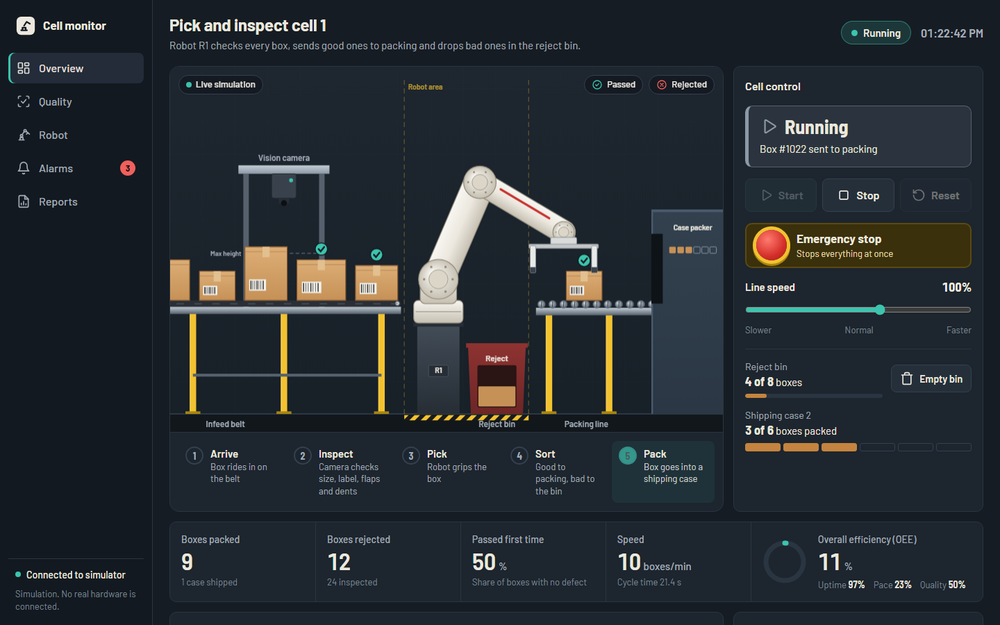
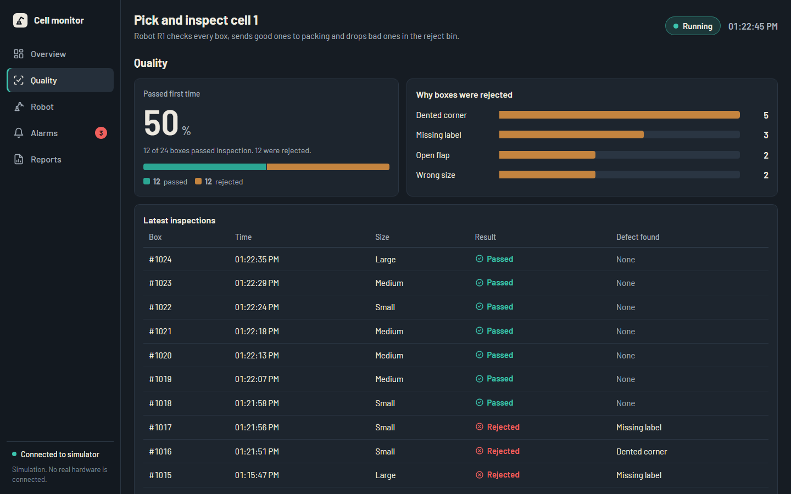
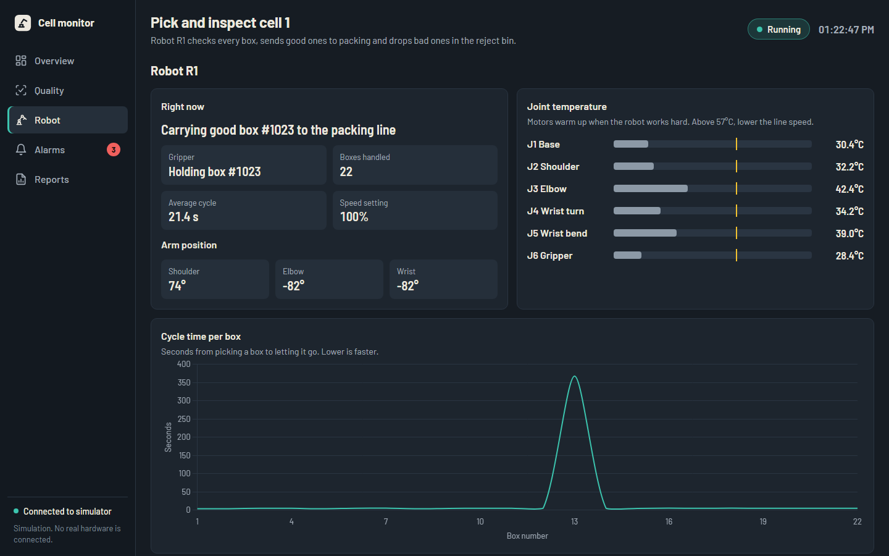
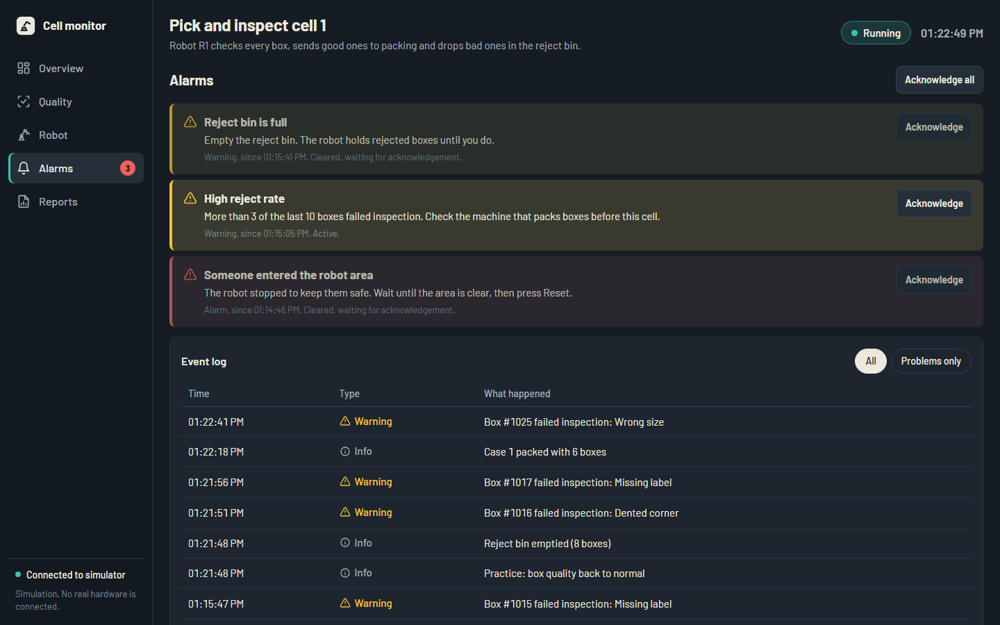
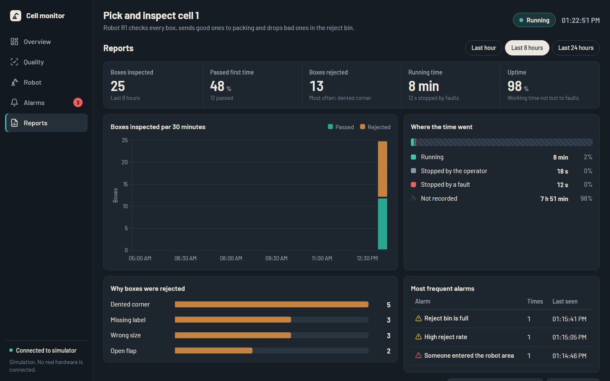
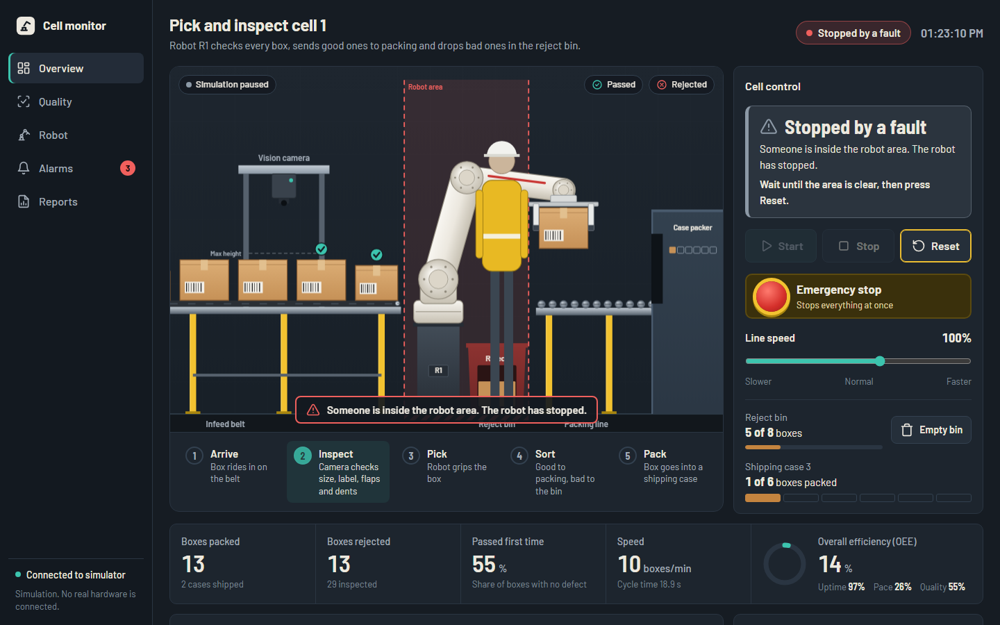
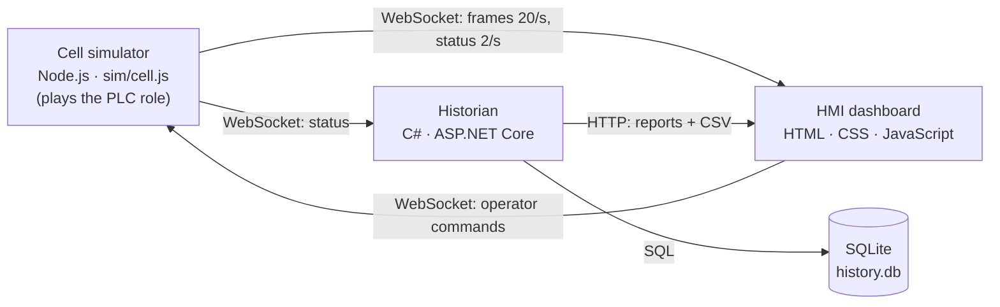
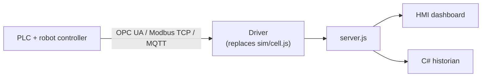

# Robot Cell HMI/SCADA Simulator


A browser-based **HMI/SCADA system** for a simulated robot quality-control cell. A robot picks boxes from a conveyor after a vision inspection, packs good boxes into shipping cases, and drops bad ones into a reject bin. Operators watch and control the cell from a live dashboard, and a **C# historian** records production data and produces shift reports.

The project covers the full supervisory chain found in a real factory: **machine logic → HMI → alarms → historian → reports**. No hardware is needed.




---

## Highlights

- **Live operator HMI.** An animated cell with process-step tracking, Start / Stop / Reset, an emergency stop, line-speed control and live KPIs.
- **Alarm management.** Alarm and warning levels, plain-language "what to do" guidance for each alarm, acknowledgement, and an event log.
- **OEE calculation.** Availability × Performance × Quality, updated live.
- **Production historian in C#.** An ASP.NET Core service subscribes to the cell over WebSocket and stores inspections, alarms and state changes in SQLite.
- **Shift reports.** Totals, uptime, downtime, reject reasons and top alarms for the last 1, 8 or 24 hours, with CSV export and a print layout.
- **Fault training.** Buttons inject realistic faults (light-curtain trip, belt jam, full reject bin, bad batch) so you can practise the recovery steps.
- **Operator-first design.** One meaning per colour, with icons and words for colour-blind users, plus large controls, a status banner and a responsive layout for desktop, tablet and phone.

---

## Screenshots

| Overview | Quality | Robot |
|---|---|---|
|  |  |  |
| **Alarms** | **Reports** | **Safety stop** |
|  |  |  |

---

## System Architecture



| Layer | Technology | Role |
|---|---|---|
| Machine logic | Node.js (`sim/cell.js`) | Simulates the cell like a PLC: state machine, robot motion, inspection, alarms, KPIs |
| HMI | HTML5 Canvas, CSS, JavaScript, Chart.js | Operator screens, controls, charts and alarm handling |
| Communication | WebSocket (`ws`), Express | Real-time two-way data between the cell, the dashboard and the historian |
| Historian | C#, ASP.NET Core, Microsoft.Data.Sqlite | Data logging, report calculations, REST API and CSV export |

---

## How It Works

### The production process

```
Infeed belt ──► Vision QC camera ──► Pick point ──► Robot ──┬──► Packing line ──► Case packer (6 per case)
                                                            └──► Reject bin (capacity 8)
```

1. **Arrive.** Boxes in three sizes (S / M / L) ride in on the infeed conveyor.
2. **Inspect.** The camera checks for four defects: open flap, missing label, dented corner and wrong size.
3. **Pick.** The robot arm picks the box using inverse kinematics with smooth acceleration.
4. **Sort.** Good boxes are packed 6 to a case. Rejected boxes go to the reject bin.

### Machine states

| State | Meaning |
|---|---|
| `stopped` | Ready. Press **Start** |
| `running` | Producing |
| `stopping` | Finishing the current box, then stops |
| `faulted` | Belt jam or someone in the robot area. Press **Reset**, then **Start** |
| `estop` | Emergency stop active. Press **Reset** once the area is clear |

Reset is refused while someone is still inside the robot area, just like a real safety interlock.

### Alarms

| Alarm | Level | Operator guidance |
|---|---|---|
| Emergency stop pressed | 🔴 Alarm | Check that everyone is clear, then press Reset |
| Someone entered the robot area | 🔴 Alarm | Wait until the area is clear, then press Reset |
| Infeed belt jammed | 🔴 Alarm | Remove the stuck box, then press Reset |
| Reject bin is full | 🟡 Warning | Empty the reject bin |
| Robot joint running hot (> 57 °C) | 🟡 Warning | Lower the line speed so the robot can cool down |
| High reject rate (> 3 of the last 10) | 🟡 Warning | Check the upstream machine |

### OEE (Overall Equipment Effectiveness)

| Factor | Formula |
|---|---|
| **Availability** | run time ÷ (run time + downtime) |
| **Performance** | (boxes sorted × ideal cycle time 5.2 s) ÷ run time |
| **Quality** | boxes passed ÷ boxes inspected |
| **OEE** | Availability × Performance × Quality |

### Fault training

| Practice button | What happens | How to recover |
|---|---|---|
| Walk into the robot area | Light-curtain safety stop; the robot freezes | Wait for the person to leave → **Reset** → **Start** |
| Jam the infeed belt | The belt stops and an alarm is raised | **Reset** → **Start** |
| Fill the reject bin | The robot holds rejected boxes and waits | **Empty bin** |
| Send a bad batch | About 50 % of boxes are defective, so a reject-rate warning appears | Press again to end the batch |

Running at 150 % line speed for a few minutes overheats the robot's elbow joint and raises a warning.

---

## Historian

The historian is a separate C# service. It subscribes to the cell over WebSocket, the way a real historian subscribes to a PLC, and stores everything in SQLite.

| Table | Contents |
|---|---|
| `inspections` | Box ID, time, size, result, defect |
| `events` | Time, level, message, alarm ID |
| `states` | Every run / stop / fault state change |

| Endpoint | Description |
|---|---|
| `GET /api/health` | Connection status, database path and record count |
| `GET /api/report?hours=8` | Shift report (1–168 h): totals, uptime, downtime, reject reasons, top alarms |
| `GET /api/export/inspections.csv?hours=8` | Inspection data as a CSV file |

---

## Getting Started

### Requirements

- [Node.js](https://nodejs.org/) 18 or newer
- [.NET 10 SDK](https://dotnet.microsoft.com/download), only needed for the historian and the Reports page

### 1. Run the cell and the dashboard

```bash
npm install
npm start
```

Open **http://localhost:3000** and press **Start**.

### 2. Run the historian (optional, in a second terminal)

```bash
npm run historian
```

The historian creates `historian/data/history.db` automatically and fills the **Reports** page. The two services can start in either order; each one waits for the other.

### Quick look without installing anything

Open `public/index.html` directly in a browser. If no server is found, the simulation runs inside the page. The Reports page needs the historian.

| Service | Address |
|---|---|
| Cell simulator + dashboard | http://localhost:3000 (`GET /api/status`) |
| Historian | http://localhost:5080 |

---

## Project Structure

```
├── server.js                 Web server: runs the cell at 20 Hz, WebSocket, serves the dashboard
├── sim/
│   └── cell.js               Cell logic: state machine, robot kinematics, inspection, alarms, KPIs, OEE
├── public/                   HMI dashboard
│   ├── index.html            Overview, Quality, Robot, Alarms and Reports pages
│   ├── css/style.css         Industrial theme, responsive and print layouts
│   └── js/
│       ├── cellView.js       Canvas animation of the cell
│       └── app.js            Live data, charts, alarms and operator commands
├── historian/                C# historian service
│   ├── Program.cs            Service setup and REST endpoints
│   ├── SimulatorClient.cs    WebSocket subscriber that records data
│   ├── HistoryStore.cs       SQLite schema and queries
│   ├── ReportBuilder.cs      Report calculations and CSV export
│   └── Models.cs             Message and report types
└── docs/
    ├── Robot-Cell-HMI-Explained.pdf   17-slide beginner guide
    ├── slides.html                    The same slides as a web page
    └── img/                           Screenshots
```

---

## Connecting to Real Equipment

The design keeps the machine logic separate from the HMI and the historian, so **only `sim/cell.js` needs replacing** to connect a real cell. A driver with the same interface (`update()`, `frame()`, `status()`, `command()`) can read and write PLC tags instead of simulating them.



| Protocol | Library |
|---|---|
| OPC UA | `node-opcua` (Node.js) or OPC Foundation UA .NET (C#) |
| Modbus TCP | `modbus-serial` |
| MQTT | `mqtt` |
| Siemens S7 / Mitsubishi MC / EtherNet/IP | `nodes7`, `mcprotocol`, `ethernet-ip` |

**Safety principle:** emergency stops and light curtains must stay hard-wired to safety-rated hardware. The HMI only displays their status and sends *requests*; the PLC decides what is safe.

---

## Limitations

This is a learning and portfolio project, not production software.

- **Simulation:** 2D side view with a planar arm. Joint temperatures are modelled, and defects are random rather than detected from images.
- **Safety:** the on-screen E-stop and light curtain are simulations only. A software button is never a safety function.
- **Security:** no user logins or roles, no HTTPS, and the historian allows requests from any origin. Intended for `localhost` only.
- **Scale:** one cell, with SQLite for storage. A plant-wide system would use SQL Server, PostgreSQL or a time-series database.
- **Dependencies:** Chart.js and fonts load from a CDN, so an internet connection is needed.

---

## Roadmap

- [ ] Connect to a real or simulated PLC over Modbus TCP or OPC UA
- [ ] User login with operator and engineer roles
- [ ] Alarm shelving and email notifications
- [ ] Trend page with historical tag values
- [ ] Automated tests
